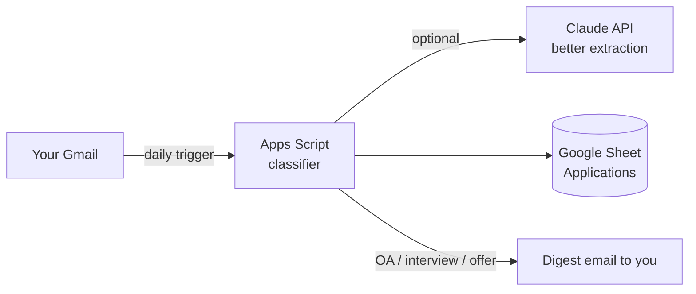

# 📬 Job Application Tracker for Gmail

Automatically turns your Gmail into a job-application tracker. Confirmations, rejections, online assessments, interview invites and offers go into a Google Sheet, and it updates itself every day.

> 中文简介：把你的 Gmail 投递邮件（投递确认 / 拒信 / OA / 面试 / offer）自动整理成一张 Google Sheet，每天自动更新。全程只在你自己的 Google 账号里运行，5 分钟装好，不用写代码。



## What you get

| Column | Example |
|---|---|
| Company | DoorDash |
| Role | Associate, Strategy & Operations |
| Status | Applied → Online assessment → Interview → Offer / Rejected / Closed |
| Applied / Last Update | 2026-10-02 / 2026-10-20 |
| Next Step | Complete assessment by Oct 27 |
| Email | link back to the Gmail thread |
| Notes | yours, never overwritten |

- Daily auto-sync, plus a **Job Tracker → Update from Gmail now** menu.
- Status only moves forward. Rejected and Closed override earlier stages.
- Job-alert newsletters (LinkedIn alerts, Jobright, Glassdoor…) are ignored.
- You get an email when a new OA, interview or offer shows up.
- Edit freely: the script keeps your Notes and only updates a row when a newer email changes its status.

## No Claude? Google Sheet version

A lighter version for anyone. It is rule-based and the data lives in your own Google Sheet.

### Setup (5 minutes) · 安装步骤

1. Create a new [Google Sheet](https://sheets.new).
2. **Extensions → Apps Script**. Delete the sample code, then paste in [`apps-script/Code.gs`](apps-script/Code.gs).
3. Optional: in Project Settings, tick *Show "appsscript.json"* and paste [`apps-script/appsscript.json`](apps-script/appsscript.json). It sets your time zone and limits permissions to read-only Gmail.
4. Choose `setup` in the function dropdown and click **Run**. Approve the permissions. Google will show "unverified app" because it's your own script: click *Advanced → Go to project*.
5. Done. The first sync scans the last 180 days. If you have a very large inbox and the run times out (Apps Script has a 6-minute limit), just run `syncApplications` again. It continues where it stopped and skips emails it has already processed.

> 1. 新建 Google Sheet → 2. 扩展程序 → Apps Script，粘贴 `Code.gs` → 3. 运行 `setup` 并授权 → 完成。之后每天早上 7 点自动更新，也可以在表格菜单 **Job Tracker** 里手动刷新。

### Optional: smarter extraction with Claude

The built-in classifier is rule-based and works offline. To get more accurate company and role names on messy emails, add an Anthropic API key:

Project Settings → Script properties → add `ANTHROPIC_API_KEY` = `sk-ant-…`

With a key set, only emails that already look like application emails are sent to the API (subject plus the first ~2,500 characters).

### Configure

Edit `CONFIG` at the top of `Code.gs`:

| Setting | Default | |
|---|---|---|
| `FIRST_RUN_LOOKBACK_DAYS` | 180 | how far back the first sync goes |
| `DAILY_HOUR` | 7 | hour of the daily sync |
| `SEND_DIGEST` | true | email yourself on OA / interview / offer |
| `NOISE_SENDERS` | alerts list | add senders to ignore |

## ⭐ Using Claude (recommended): the full dashboard

If you use Claude with Gmail connected, the skill in [`claude-skill/gmail-job-tracker/`](claude-skill/gmail-job-tracker/) builds the **full live dashboard**:

- KPI cards, a pipeline bar, a weekly chart and status chips
- Excel-style header filters, stars, and inline editing
- A JD-link column, plus **paste a JD → row auto-filled**
- A **↻ Update from Gmail** button and a daily auto-update, with push alerts for OAs and interviews
- Claude reads every email in full before deciding a status, so it is more accurate than keyword rules

**Install (2 minutes) · 安装**
1. Download [`gmail-job-tracker-skill.zip`](gmail-job-tracker-skill.zip).
2. In Claude, go to **Settings → Capabilities → Skills → Upload skill** and upload the zip.
3. Connect Gmail: **Settings → Connectors → Gmail**.
4. Ask Claude: **"Build my job tracker from my Gmail"** / 「用我的 Gmail 做一个求职 tracker」.

> 用 Claude 的朋友推荐用这个：和作者自用的版本一模一样，数据只在你自己的 Claude 账号里。

## Privacy · 隐私

- Everything runs inside **your own** Google account. There is no server, no third party, and no tracking.
- The Gmail permission is **read-only**. The script never sends, deletes or labels your mail. Its only outgoing email is the digest it sends to you.
- Uninstall: Apps Script → Triggers → delete the trigger, or just delete the sheet.

## Development

```bash
npm test     # runs the classifier against anonymized sample emails
```

The classifier functions (`classifyEmail`, `extractRole`, `extractCompany`, …) are pure, so you can test them in Node. PRs with new anonymized test cases are welcome, especially from ATS systems that aren't covered yet.

## License

MIT
